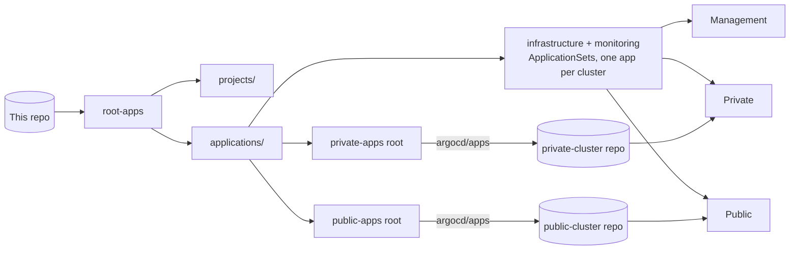

# Management Cluster

This repository defines the management cluster of a three-cluster Talos homelab. ArgoCD runs on this cluster. It reconciles this cluster and the two leaf clusters, `private-cluster` and `public-cluster`. The repository holds manifests, scripts and tooling only.

## Topology



- **One cluster manages the others.** Each leaf cluster is registered as an ArgoCD destination. The registration is an ExternalSecret in `argocd/manifests/*-cluster-credentials.yaml`. The ExternalSecret pulls the service-account token, the CA and the API host of the leaf cluster from Key Vault. The management cluster registers itself as the `in-cluster` destination.

- **App-of-apps with two roots.** `root-apps/` holds two root Applications. One root recurses `projects/`. The other root recurses `applications/`. Every workload on every cluster is reachable from these two roots. A fresh cluster bootstraps from a single `kubectl apply` of the two roots.

- **One AppProject per category.** `projects/` defines five AppProjects: `infrastructure`, `management`, `monitoring`, `private` and `public`. Each AppProject lists the source repositories, destination clusters and namespaces that its Applications may use. ArgoCD rejects an Application whose destination is absent from its AppProject.

- **Shared platform on every cluster.** Infrastructure and monitoring components are ApplicationSets with the cluster generator. When you register a cluster, the ApplicationSets give it Cilium, cert-manager, external-dns, External Secrets, the Synology CSI driver and the OpenTelemetry collectors. Per-cluster differences, for example the ClusterMesh identity, come from annotations on the cluster secret and from `infrastructure/cilium-config/<cluster>/`.

- **Leaf clusters own their workloads.** This repository knows that the private cluster and the public cluster exist. It holds no information about the workloads on them. `applications/private/` and `applications/public/` each hold one Application. That Application syncs the `argocd/apps` directory of the matching leaf repository. The leaf repository holds the Application CRs and the Kustomize bases for its apps. To add an app, you change the leaf repository only.

## Layout

```
.
├── root-apps/         # Two root Applications: one recurses applications/, one recurses projects/
├── projects/          # One AppProject per category
├── applications/      # Application CRs and ApplicationSets, applications/<project>/<app>/
├── argocd/            # ArgoCD install: Helm values, namespace, cluster and repository credentials, tunnel
├── infrastructure/    # Manifests for the infrastructure AppProject
├── monitoring/        # Manifests for the monitoring AppProject
├── tasks/             # mise tasks for cluster, Cilium and credential bootstrap
├── scripts/setup      # Devcontainer post-create script: trusts mise.toml and installs the pinned tools
├── mise.toml          # Pinned tools and task configuration, managed by Renovate
└── renovate.json
```

## What runs here

- **Platform.** Cilium is the CNI on every cluster. ClusterMesh joins the clusters. A service marked global on one cluster is reachable by name from the other clusters. CloudNativePG runs the Postgres databases. The Barman plugin backs the databases up to Azure Blob Storage. cert-manager issues certificates. external-dns manages DNS records. External Secrets delivers credentials from Key Vault. The Synology CSI driver provides persistent volumes.

- **Registry.** Harbor runs on the management cluster. It is the image registry for the homelab and a pull-through proxy for public registries such as Docker Hub and GHCR. The nodes of the management cluster pull through Harbor. That node configuration lives in `talos-configs`.

- **Observability.** Every cluster runs OpenTelemetry collectors as node agents. The agents send telemetry to a gateway on the same cluster. Each gateway forwards over ClusterMesh to one aggregator on the management cluster. The aggregator fans out to Prometheus, Loki and Tempo. Grafana reads from all three. Workstations send OTLP to the same aggregator. The OTel Operator manages the collectors. `monitoring/otel-satellite-services/` exposes the backends across the mesh.

- **Dependencies.** Renovate runs as a CronJob on this cluster. It opens pull requests in the homelab repositories for image tags, Helm charts, Talos and Kubernetes versions, and the tools pinned in `mise.toml`. Its configuration is in `renovate.json` and `infrastructure/renovate/`.

## How a change deploys

Every Application pins `targetRevision: HEAD`. Deployments therefore track `main`. A commit on another branch does not deploy. To deploy a change, merge its pull request. ArgoCD syncs automatically with self-heal and prune enabled.

## Working in this repository

The devcontainer installs the tools pinned in `mise.toml`.

Cluster access uses one kubectl context per cluster:

1. Run `mise run gather-configs`. It fetches a kubeconfig for every cluster from Omni and merges them.
2. Run `kubectl --context <name>` to target one cluster.

Operate the leaf clusters from this environment. The tooling in the leaf repositories is for emergencies only.

Bootstrap is a sequence of mise tasks under `tasks/`. Run `mise tasks` to list them with descriptions. `fresh-clone` prepares the devpod. `bootstrap-clusters` takes a newly provisioned set of Talos clusters through Cilium, namespaces, secrets and the ArgoCD install. It then hands over to GitOps.

Secrets are ExternalSecrets against an Azure Key Vault ClusterSecretStore. One credential cannot come from the vault: the Service Principal that reads the vault. `bootstrap-azure-creds` seeds that credential into each cluster. `.env` is git-ignored and local to a checkout.

## Related repositories

- [public-cluster](https://github.com/bde-dev/public-cluster): the internet-facing workloads and their Application CRs.
- `private-cluster`: the same shape for the private cluster. This repository is private.
- [talos-configs](https://github.com/bde-dev/talos-configs): Omni cluster templates that define the operating system and Kubernetes layer of each cluster.
